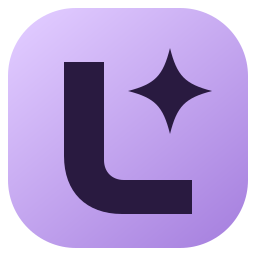

  

<h1 align="center">Latent v2</h1>

  <strong>A friendly Windows desktop studio for making, editing and animating AI images on your own PC.</strong> 
  No terminals, no node graphs, no Python to install. Just download, run setup and start creating.

  
  
  
  

---

## ✨ What you can do

- **Create** images from a prompt with SDXL, Illustrious and other SDXL-based models. Pick a size preset, add LoRAs (their trigger words show up for you), and use wildcards and prompt variations for endless remixes.
- **Enhance** saved images with upscaling, gentle hires passes and optional automatic face touch-ups.
- **Edit with Qwen**: change an image with plain-language instructions, make new images from text, or ask for a transparent background.
- **Video**: turn ideas and images into short clips.
- **Library**: browse everything you've made, compare results, sort them into collections, and reuse any image's exact settings in one click.
- **Models** and **Discover**: manage your model files and browse Civitai for new checkpoints and LoRAs right inside the app.

Everything runs locally. Your prompts, images and models stay on your computer.

## 📥 Getting started

1. **Download** the newest `Latent-v2-…-Setup-x64-unsigned.exe` from the [latest release](https://github.com/GhostNoodl/Latent-v2/releases/latest).
2. **Run the installer.** Windows may show a blue "Windows protected your PC" box because the installer isn't code-signed yet. Click **More info**, then **Run anyway**.
3. **Follow Setup** when the app opens. It checks your graphics card and free space, installs the generation engine, and lets you choose which image, editing or video pieces you want. Every download is shown to you before it starts.
4. **Make something!** Head to **Create**, type a prompt and hit Generate. 🎨

### 🔄 Staying up to date

Open **Settings › App updates** to check for new versions and install them right from the app (available from version 0.2.2 onward). You can also turn on automatic checking and downloading there. Updates never touch your models, images or settings. On an older version? Just download the newest installer and run it over the top.

## 🖥️ What you'll need

| | Images | Qwen editing and video |
| --- | --- | --- |
| **System** | Windows, 64-bit | Windows, 64-bit |
| **Graphics card** | NVIDIA RTX with 8 GB or more | NVIDIA RTX with 16 GB or more |
| **Memory (RAM)** | 16 GB | 32 GB |
| **NVIDIA driver** | 580.88 or newer | 580.88 or newer |
| **Disk space** | About 15 GB for the engine, plus your models | Same, plus larger models |

You'll also need an internet connection during setup and for model downloads. You do **not** need Python, Git, Node.js or the CUDA toolkit. Latent handles all of that for you.

## 💬 Questions and answers

**Where are my images and models saved?**
In `%LOCALAPPDATA%\Latentv2` by default. **Settings** shows the exact location, and you can point model folders somewhere else if you like.

**Will uninstalling delete my stuff?**
Nope. Uninstalling keeps your studio, models and images, and reinstalling picks them right back up.

**Can I use my existing ComfyUI install or models?**
Latent runs its own private ComfyUI engine, so it won't take over an existing install. You can add your existing model folders from the **Models** page instead of downloading everything again.

**Does anything get sent online?**
Only what you choose: setup and model downloads come from their publishers, and **Discover** talks to Civitai. If you turn on automatic model info lookup, file checksums are sent to Civitai to find matching models. Your images stay local unless you export them.

**Something's not working.**
Sorry about that! Please [open an issue](https://github.com/GhostNoodl/Latent-v2/issues/new/choose) and tell us what happened, your Latent version (shown in **Settings**) and your graphics card.

## 📚 More guides

- [Qwen Image Station](docs/QWEN-IMAGE-STATION.md) and [Compact Qwen editing](docs/QWEN-COMPACT.md)
- [Starter wildcard packs](docs/WILDCARD-PACKS.md)
- [Offline tag autocomplete](docs/TAG-AUTOCOMPLETE.md)
- [How app updates work](docs/APP-UPDATES.md)

## 🛠️ For developers

Build Latent v2 from source

Use Windows x64 and Node 24.15+ in the Node 24 line, or Node 26+. Run `npm ci`, `npm run public:check`, `npm test`, then `npm run build`. `npm start` launches the desktop app. `npm run package -- --output my-build` creates an unsigned portable package. End users do not need Node in a packaged build. If your npm policy disables dependency install scripts and packaging reports a missing Electron distribution, run `node node_modules/electron/install.js` to install the locked Electron build before packaging; do not change global script policies.

Your studio is stored under the current user's local application data. Models, prompts, images, logs, keys and the database are private user data. Do not include a locally generated studio pointer with public downloads.

This repository includes an explicit, self-contained regression suite. Historical GPU receipts, screenshots, development scripts and tests requiring those private captures remain in the private development repository. Included tests use temporary generated fixtures and do not establish live-service, GPU or fresh-machine compatibility.

See [distribution controls](docs/DISTRIBUTION.md) and [the 0.2 update notes](docs/UPDATE-0.2.md).

## 📄 License

Latent v2's own code is released under the [MIT License](LICENSE). Third-party components, the ComfyUI engine and any models you download keep their own licenses. See [third-party components](THIRD_PARTY.md) for details.
